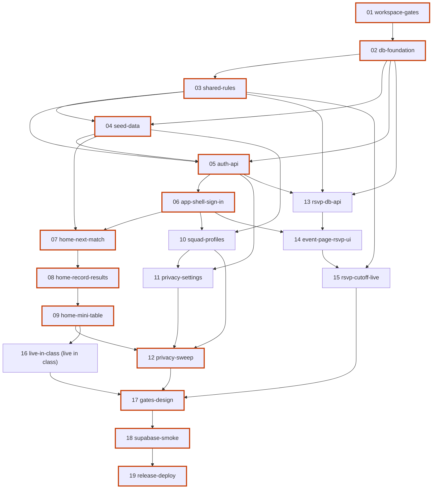

# PLAN

Built from `docs/REQUIREMENTS.md`, `docs/design/*` and `DECISIONS.md`. Plan files: `plans/session-NN-<name>.md`. Checked by `node scripts/plan-check.mjs` (part of `npm run gate` once session 01 adds the script).

Rules of the plan: one session = one layer or one feature, about 20–30 minutes, every test green at its end. A check is **owned** by the session that finishes all its tests; earlier sessions may add `[api]` or `[db]` tests for it (D-31). Every install needs the owner's yes (D-32). The production deploy is the last step of the last session and needs the owner's "yes".

## Dependency graph (what must exist before what)

Orange outline = critical path.

## Run order
01. **workspace-gates** (30 min). Depends on: none.
02. **db-foundation** (30 min). Depends on: 01.
03. **shared-rules** (25 min). Depends on: 02.
04. **seed-data** (30 min). Depends on: 02, 03.
05. **auth-api** (30 min). Depends on: 02, 03, 04.
06. **app-shell-sign-in** (30 min). Depends on: 05.
07. **home-next-match** (30 min). Depends on: 04, 06.
08. **home-record-results** (30 min). Depends on: 07.
09. **home-mini-table** (25 min). Depends on: 08.
10. **squad-profiles** (30 min). Depends on: 06, 04.
11. **privacy-settings** (25 min). Depends on: 05, 10.
12. **privacy-sweep** (25 min). Depends on: 09, 10, 11.
13. **rsvp-db-api** (30 min). Depends on: 02, 03, 05.
14. **event-page-rsvp-ui** (30 min). Depends on: 06, 13.
15. **rsvp-cutoff-live** (30 min). Depends on: 03, 14.
16. **live-in-class** (20 min). Depends on: 09. **Live in class.**
17. **gates-design** (30 min). Depends on: 12, 15, 16.
18. **supabase-smoke** (30 min). Depends on: 17.
19. **release-deploy** (30 min). Depends on: 18.

## Critical path
01 → 02 → 03 → 04 → 05 → 06 → 07 → 08 → 09 → 12 → 17 → 18 → 19 — 13 sessions, about 375 minutes of work. Sessions off this path (for example 10, 11, 13 and 16) can slip without moving the end, as long as the sessions that depend on them wait.

## Check → owning session (every check has exactly one owner)

| Check | Test levels | Owner |
|---|---|---|
| AC-1.1.1 | API + E2E | session-06 |
| AC-1.1.3 | API + E2E | session-06 |
| AC-1.1.4 | API | session-05 |
| AC-1.6.1 | API + E2E | session-06 |
| AC-1.6.2 | API + E2E | session-06 |
| AC-1.6.3 | API + E2E | session-06 |
| AC-1.6.4 | E2E | session-06 |
| AC-2.1.1 | DB + API + E2E | session-07 |
| AC-2.1.2 | DB | session-07 |
| AC-2.1.3 | U + E2E | session-07 |
| AC-2.1.4 | U + E2E | session-07 |
| AC-2.1.5 | API + E2E | session-07 |
| AC-2.1.6 | U | session-03 |
| AC-2.2.1 | DB + API | session-08 |
| AC-2.2.2 | DB | session-08 |
| AC-2.2.3 | DB | session-08 |
| AC-2.2.4 | API + E2E | session-08 |
| AC-2.3.1 | DB + API | session-08 |
| AC-2.3.2 | DB + API | session-08 |
| AC-2.4.1 | DB + E2E | session-09 |
| AC-2.4.2 | E2E | session-09 |
| AC-2.4.3 | E2E | session-16 |
| AC-4.1.1 | DB + API + E2E | session-10 |
| AC-4.1.2 | DB + API + E2E | session-10 |
| AC-4.1.3 | DB + API | session-10 |
| AC-4.2.1 | API + E2E | session-10 |
| AC-4.2.2 | DB + API + E2E | session-10 |
| AC-4.3.1 | DB + API + E2E | session-12 |
| AC-4.3.2 | API + E2E | session-11 |
| AC-4.3.3 | DB + API | session-11 |
| AC-4.3.4 | DB + API | session-11 |
| AC-3.3.1 | DB + API + E2E | session-14 |
| AC-3.3.2 | DB + API | session-13 |
| AC-3.3.4 | DB + API + E2E | session-15 |
| AC-3.3.5 | U + E2E | session-15 |
| AC-3.3.6 | DB + API | session-13 |
| AC-3.4.1 | DB + API + E2E | session-14 |
| AC-3.4.3 | DB + API + E2E | session-14 |
| AC-5.2 | E2E (axe) | session-17 |
| AC-5.4 | E2E | session-17 |

38 acceptance checks plus the AC-5.2 and AC-5.4 gates = 40 rows.

## Other test groups → session
| Group | Session(s) |
|---|---|
| GATE-1 | session-01 |
| GATE-2 | session-01 |
| GATE-3 | session-01 |
| GATE-4 | session-01 |
| T-01 | session-02 |
| MATRIX-1 | session-02 |
| MATRIX-2 | session-02 |
| RULE-1 | session-03 |
| RULE-2 | session-03 |
| RULE-3 | session-03 |
| RULE-4 | session-03 |
| RULE-5 | session-03 |
| RULE-6 | session-03 |
| SEED-1 | session-04 |
| SEED-2 | session-04 |
| SEED-3 | session-04 |
| T-07 | session-05 |
| T-08 | session-05 |
| T-16 | session-05 |
| T-23 | session-05 |
| T-19 | session-06 |
| SHELL-1 | session-06 |
| T-11 | session-08 |
| T-10 | session-10 |
| T-06 | session-11 |
| T-02 | session-12 |
| T-12 | session-12 |
| T-03 | session-13 |
| T-04 | session-13 |
| T-22 | session-13 |
| T-05 | session-14 |
| LIVE-1 | session-15 |
| T-17 | session-15 |
| T-13 | session-17 |
| T-14 | session-17 |
| T-15 | session-17 |
| T-18 | session-17 |
| SMOKE-1 | session-18 |
| SMOKE-2 | session-18 |
| SMOKE-3 | session-18 |
| SMOKE-4 | session-18 |
| REL-1 | session-19 |

## Live in class
**session-16 live-in-class** (AC-2.4.3, the snapshot date on the mini table). About 20 minutes, one component, one test that goes red then green. It depends only on session 09 and can run any time after it.

## Design sessions (after session 19; not in the dependency graph above)
Session 20 is the design session (owner's brief, 18 Nov 2026): make the site look like a real club site without changing behaviour, API, database or test ids. It is split into small sessions, each ending with `npm run gate` green. It has no acceptance check of its own, so `plan:check` is unchanged; its tests are the `DESIGN-n` group in `docs/design/test-map.md`. The 20a–20e split and the owner's answers are in `PROGRESS.md` and `DECISIONS.md` (D-157 onwards).
- **20a** tokens and spacing foundation (colour, spacing, type scale, weights, `.stack`, one accent, focus tokens). Fixes the cramped fixture cards.
- **20b** the league table at 320 px and the "Not going" button, plus a 320/390/768/1280 layout matrix.
- **20c** no-people assets: `public/img/*.svg`, crest, jersey, initials avatar, the CSP `img-src 'self' data:`.
- **20d** desktop layout up to 1200 px with a grid inside it.
- **20e** club polish: hero, next-match card, results rows, footer, screenshots at four widths.

## Release
Session 19's last step is the production deploy and needs the owner's explicit "yes". Session 18 needs the owner to create the Supabase project (I give the steps then) and confirms the JWT-lifetime setting on the Free plan (D-13).
